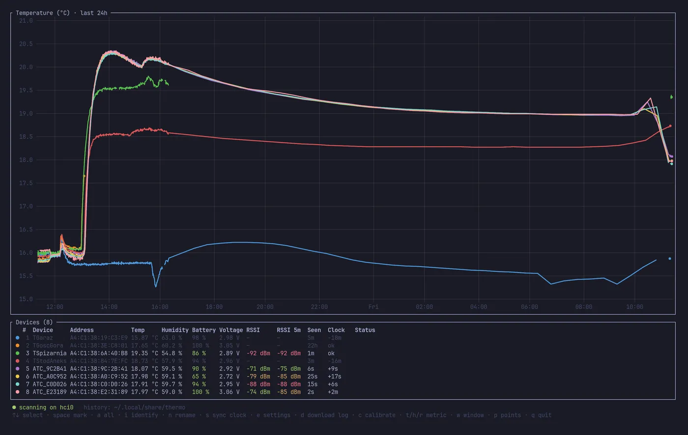
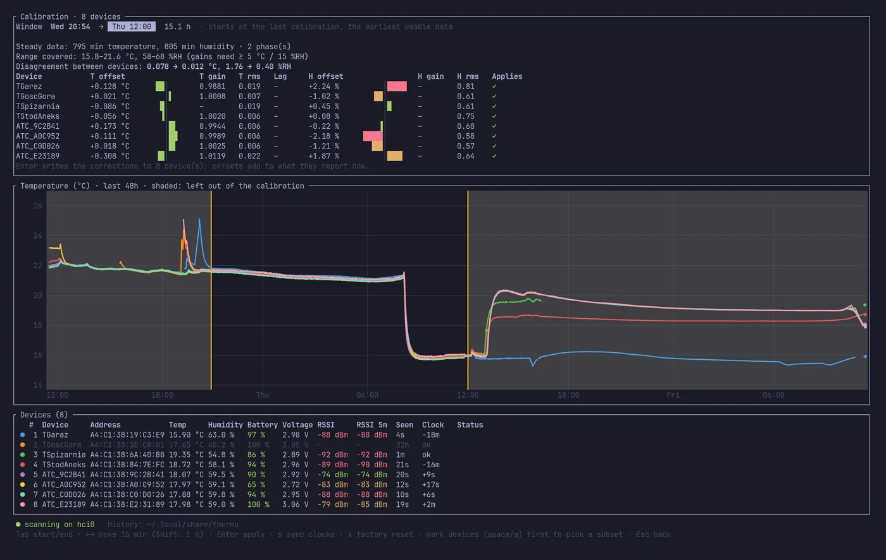

# thermo: dashboard and calibration for Xiaomi LYWSD03MMC thermometers

[](https://github.com/arturzielazny/atc-thermo/actions/workflows/ci.yml)
[](#license)

A Linux terminal app for BLE thermometers running the
[pvvx ATC_MiThermometer](https://github.com/pvvx/ATC_MiThermometer) firmware with
**BTHome v2** advertising (tested on eight Xiaomi LYWSD03MMC). It shows live readings
and fills gaps from each device's log, even though the device clocks are wrong. It also
syncs and trims those clocks, renames devices and changes their settings in bulk. Put
all the thermometers side by side and it **calibrates them against each other**, writing
a gain and offset into each one, so Home Assistant and every other BTHome receiver get
the corrected values too.

**Website and guides:** https://arturzielazny.github.io/atc-thermo/



## Features

- **Live dashboard:** a chart (temperature, humidity or signal strength) above one row
  per device with battery, voltage, latest and 5-minute median RSSI, last seen and
  clock offset. In Ghostty or kitty the chart is a pixel image passed through shared
  memory; elsewhere (SSH, tmux) it's drawn in braille.
- **History:** saved to `~/.local/share/thermo/YYYY-MM-DD.csv` and reloaded on start.
  Gaps in the last 24 h are filled from each device's own log, with its timestamps
  corrected for clock offset and drift.
- **Consensus calibration:** no reference instrument needed. A robust fit pulls every
  device onto the group average, rejects outliers, fits gains only when the data spans
  enough range, and writes the corrections to flash. See
  [the calibration guide](https://arturzielazny.github.io/atc-thermo/calibration.html)
  and [docs/calibration.md](docs/calibration.md).
- **Clock sync with drift trim**: the clocks ran ~200 ppm fast here.
- **Bulk actions:** rename, advertising interval, measurement interval, TX power, log
  interval, log download, identify (shows the device's number on its own LCD).
- **Signal levelling:** listens for a while, then sets each device's TX power so it
  arrives at about −70 dBm: still reliable, with no battery spent on a louder radio.



## Install

Linux with BlueZ, Rust ≥ 1.88, and the D-Bus headers:

```sh
sudo apt install libdbus-1-dev pkg-config          # Debian, Ubuntu, Raspberry Pi OS
sudo dnf install dbus-devel pkgconf-pkg-config     # Fedora
sudo pacman -S --needed dbus pkgconf               # Arch

cargo install --git https://github.com/arturzielazny/atc-thermo thermo
thermo
```

`thermo calibrate 6` prints a calibration proposal for the last 6 hours of saved
history without touching any device.

### Flash the thermometers first

Stock Xiaomi firmware encrypts its adverts and has no calibration interface. Flash the
pvvx firmware wirelessly from a browser with
[TelinkMiFlasher](https://pvvx.github.io/ATC_MiThermometer/TelinkMiFlasher.html), then
set the advertising type to **BTHome v2**. Chrome on Linux needs
`chrome://flags/#enable-experimental-web-platform-features` enabled for Web Bluetooth;
Chrome on Android works out of the box.

## Keys

| Key | Action |
|---|---|
| `↑` `↓` | select a device · `Esc` clears marks, then the selection |
| `space` / `a` | mark one / all devices: actions apply to marked devices, or the selected one |
| `i` | identify: show the device's `#` from the table on its screen for 30 min (`333` for #3, with a smiley) |
| `n` | rename the selected device |
| `s` | sync device clocks with this computer and trim the drift measured since the last sync |
| `e` | settings: advertising interval, measurement interval, TX power, log interval |
| `d` | download the device log for the last 24 h |
| `l` | signal levelling: `←` `→` target 1 dB, `Enter` change TX power, `x` factory TX power (both confirmed with `y`), `r` listen anew; mark devices there to level only those |
| `c` | calibration screen: `Tab` start/end, `←` `→` move 15 min (`Shift`: 1 h), `Enter` apply, `x` factory reset |
| `t` `h` `r` · `w` · `p` | temperature / humidity / signal strength · chart time span · lines or points |
| `q` | quit |

## Calibrating in short

1. All thermometers side by side for at least 2 h, away from heat sources.
2. Move them all at once somewhere at least 5 °C different for at least 3 h.
3. Press `c`, set the window to cover both steady phases but not the move, check the
   proposal, press `Enter` and confirm with `y`.

Agreement isn't absolute accuracy. For absolute humidity, add a salt test (75.3 %RH
over saturated NaCl).

## Android

[`android/`](android) has the same features as an Android app, built for touch: cards,
a chart with a crosshair, multi-select actions, a range slider for the calibration
window, and recording in the background. Its history files are the same CSVs and can be
moved between phone and computer. See [android/README.md](android/README.md).

## Customize it with an AI agent

[AGENTS.md](AGENTS.md) describes the architecture, what's platform-specific and how to
port it, for Claude Code, Codex and similar agents. The
[agents guide](https://arturzielazny.github.io/atc-thermo/agents.html) has ready-made
prompts: port to macOS or Windows, run headless on a Raspberry Pi with MQTT or
InfluxDB, Fahrenheit display, other pvvx devices.

## Crates

| Crate | |
|---|---|
| [`crates/bthome`](crates/bthome) | dependency-free BTHome v2 payload decoder |
| [`crates/calibration`](crates/calibration) | consensus calibration of co-located sensors, dependency-free |
| [`crates/atc`](crates/atc) | async BLE client for the pvvx firmware's command interface (config, name, clock and its rate, coefficients, LCD, log download) |
| [`crates/thermo`](crates/thermo) | the dashboard |

`scripts/` holds the original Python prototypes (`bthome_listen.py`, `atc_config.py`).

## Contributing

Issues and pull requests are welcome, especially reports from other pvvx-supported
models. Please run `cargo fmt`, `cargo clippy --workspace --all-targets -- -D warnings`
and `cargo test --workspace` first.

## License

Licensed under either of [Apache License 2.0](LICENSE-APACHE) or [MIT](LICENSE-MIT) at
your option. Not affiliated with Xiaomi. Built on the work of
[pvvx](https://github.com/pvvx/ATC_MiThermometer) and [BTHome](https://bthome.io).
