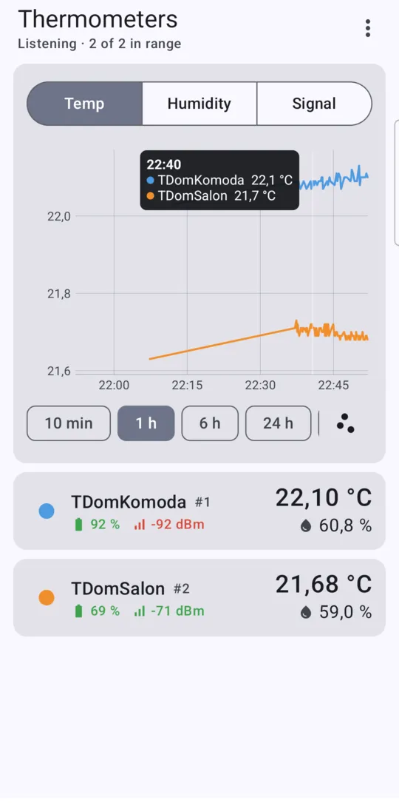
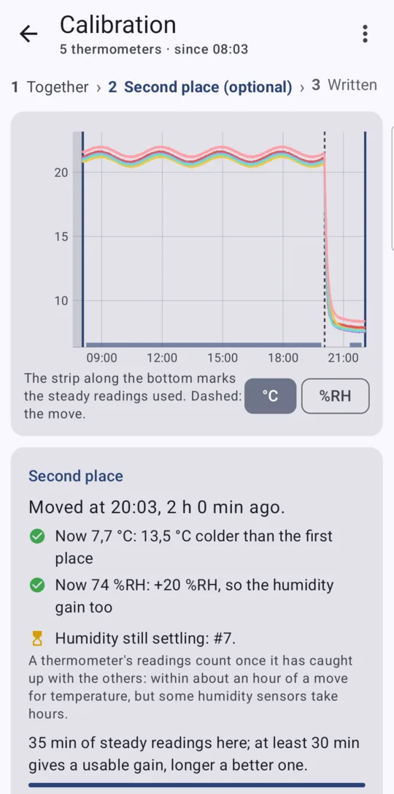
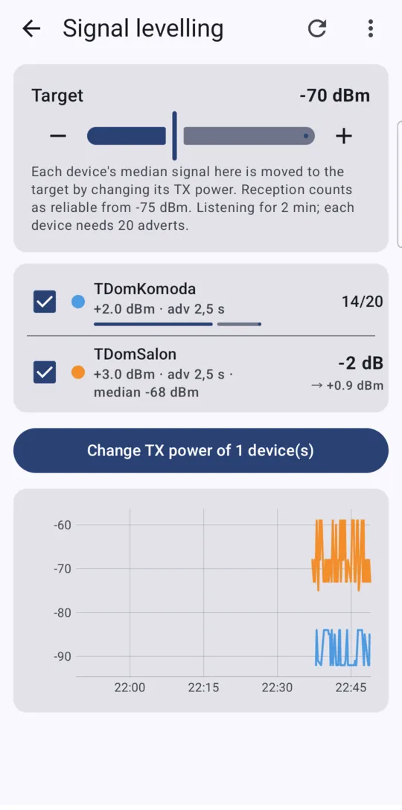

# thermo: calibrate Xiaomi LYWSD03MMC thermometers with your phone

An Android app for BLE thermometers running the
[pvvx ATC_MiThermometer](https://github.com/pvvx/ATC_MiThermometer) firmware with
**BTHome v2** advertising (tested on Xiaomi LYWSD03MMC), or the
[pvvx THB2](https://github.com/pvvx/THB2) firmware (THB1, THB2, BTH01, TH05, …). It shows
live readings, fills gaps from each device's own log even though the device clocks are
wrong, syncs and trims those clocks, and renames devices and changes their settings in
bulk. Put the thermometers side by side and it **calibrates them against each other** in
a guided session that tells you how precise the corrections already are, then writes a
gain and offset into each one, so Home Assistant and every other BTHome receiver get the
corrected values too.

**Website and guides:** https://arturzielazny.github.io/atc-thermo/

## Install

Android 8 or newer: download the APK from the
[latest Android release](https://github.com/arturzielazny/atc-thermo/releases) and open it
on the phone. There is no store listing yet. To build it yourself, see
[android/README.md](android/README.md).

### Flash the thermometers first

Stock Xiaomi firmware encrypts its adverts and has no calibration interface. Flash the
pvvx firmware wirelessly from a browser with
[TelinkMiFlasher](https://pvvx.github.io/ATC_MiThermometer/TelinkMiFlasher.html) (Chrome on
Android works out of the box), then set the advertising type to **BTHome v2**.

## What it does

- **Dashboard:** a chart of temperature, humidity or signal strength you can scrub with a
  finger, above a card per thermometer. History is kept as one CSV per day.
- **Keeps recording** with the app closed, also after a reboot or an update, and fills
  gaps from each device's log, with its timestamps corrected for clock offset and drift.
- **Consensus calibration:** no reference instrument needed. Pick the thermometers lying
  side by side; the app shows how precise corrections written now would be and how long a
  better level takes, guides an optional move to a second place for the gains, and writes
  the corrections to flash. Or it corrects them to match one device you trust. See
  [the calibration guide](https://arturzielazny.github.io/atc-thermo/calibration.html).
- **Humidity from salt:** calibrate in a sealed box over damp kitchen salt, which holds
  75 %RH, and once the box has settled the humidity is corrected to the salt instead of
  the group's average.
- **Spoken progress** during a calibration, about four times an hour, with news at once,
  for a phone lying next to the thermometers.
- **Clock sync with drift trim:** the clocks ran about 200 ppm fast here.
- **Bulk actions:** rename, advertising and measurement interval, TX power, log interval,
  log download, identify (shows the device's number on its own LCD).
- **Signal levelling:** listens for a while, then sets each device's TX power so it
  arrives at about −70 dBm: reliable, without a louder radio than it needs.

[android/README.md](android/README.md) has the details: the calibration session, the
precision estimate and how it was checked on real data, files, build and code layout.

## The terminal version (archived)

thermo started as a terminal dashboard for Linux and macOS, in Rust. It is no longer
developed and lives on, unchanged, in [archive/tui](archive/tui). The Android app has
since gone further, in calibration above all. If you would rather have it on a computer,
an AI coding agent can bring the terminal version up to the app's features: the Android
code is the reference, and both keep the same files.

## Customize it with an AI agent

[AGENTS.md](AGENTS.md) describes the architecture and the rules for working near real
devices, for Claude Code, Codex and similar agents. The
[agents guide](https://arturzielazny.github.io/atc-thermo/agents.html) has ready-made
prompts. The Android app itself was ported from the terminal version this way.

## License

Licensed under either of [Apache License 2.0](LICENSE-APACHE) or [MIT](LICENSE-MIT) at
your option. Not affiliated with Xiaomi. Built on the work of
[pvvx](https://github.com/pvvx/ATC_MiThermometer) and [BTHome](https://bthome.io).
